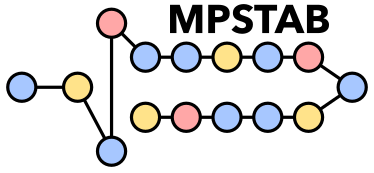

<picture>
  <source media="(prefers-color-scheme: dark)" srcset="./docs/_static/logo/mpstab_logo_dark.svg">
  
</picture>

---

# MPSTAB: Hybrid Stabilizers-MPO Quantum Circuit Simulator

[](https://www.python.org/)
[](tests/)
[](htmlcov/index.html)
[](https://matteorobbiati.github.io/mpstab/index.html)

## Overview

**MPSTAB** is a cutting-edge quantum circuit simulator implementing a hybrid **stabilizers-MPO** (Matrix Product Operator) formalism in pure Python. This package provides an efficient framework for simulating quantum circuits by leveraging the power of both stabilizer states and tensor network methods, enabling accurate simulation of larger quantum systems with reduced computational overhead.

The simulator offers in-house stabilizers and tensor network engines, alongside with state-of-art Python packages such as [Stim](https://github.com/quantumlib/Stim) and [Quimb](https://quimb.readthedocs.io/).
The quantum circuits and observables interface is inherited from the open-source Python project [Qibo](https://qibo.science/).


## Key Features

- 🎯 **Hybrid Formalism**: Combines stabilizer states with tensor networks for efficient simulation
- 🚀 **Flexible engines**: Flexible backend support: from in-house Clifford simulator and Tensor Network engines to [Stim](https://github.com/quantumlib/Stim) and [Quimb](https://quimb.readthedocs.io/).
- ⚙️ **[Qibo](https://qibo.science/) backend provider**: `mpstab` can be used as a backend provider for Qibo, a state-of-art full-stack quantum computing framework.
- 📊 **Fidelity Tracking**: Built-in fidelity lower bounds and truncation monitoring
- 🔧 **Pre-computed quantum circuit Ansätze**: Pre-built quantum circuits for variational algorithms
- 🧮 **Arbitrary Observables**: Support for Pauli string expectation values
- ⚡ **Differentiability**: Integrated with Quimb, `mpstab` inherits differentiability over the circuit executions

## Installation

### Using uv (Recommended)

We recommend [uv](https://docs.astral.sh/uv/) for fast, reproducible environment management.

```bash
# Clone the repository
git clone https://github.com/MatteoRobbiati/mpstab.git
cd mpstab

# Install uv (if not already installed)
curl -LsSf https://astral.sh/uv/install.sh | sh

# Create the virtual environment and install base dependencies
uv sync

# Activate the virtual environment
source .venv/bin/activate      # macOS / Linux
.venv\Scripts\activate         # Windows
```

#### Optional backends

PyTorch and JAX are not installed by default. Add them with `--extra`:

```bash
# PyTorch backend
uv sync --extra pytorch

# JAX backend
uv sync --extra jax

# Both backends
uv sync --extra pytorch --extra jax
```

#### Development dependencies

Optional dependency groups (`dev`, `test`, `docs`, `benchmark`) are installed with `--group`:

```bash
# Testing
uv sync --group test

# Documentation
uv sync --group docs

# Development tools
uv sync --group dev

# Everything at once
uv sync --all-extras --all-groups
```

### Using pip

```bash
git clone https://github.com/MatteoRobbiati/mpstab.git
cd mpstab
pip install .

# With optional backends
pip install ".[pytorch]"
pip install ".[jax]"
pip install ".[pytorch,jax]"
```


## Quick Start

### Basic Circuit Simulation

```python
from mpstab import HSMPO
from mpstab.models.ansatze import HardwareEfficient

# Create a quantum circuit ansatz
ansatz = HardwareEfficient(nqubits=8, nlayers=3)

# Initialize the hybrid stabilizer MPO simulator
surrogate = HSMPO(ansatz=ansatz, max_bond_dimension=16)

# Compute expectation value of a Pauli observable
observable = "ZIZXIIIZ"
expectation_value = surrogate.expectation(observable)
print(f"<{observable}> = {expectation_value}")

# Access fidelity lower bound (indicates truncation error)
fidelity = surrogate.fidelity_lower_bound
print(f"Fidelity Lower Bound: {fidelity}")
```


## Testing

Run the complete test suite:

```bash
pytest
```

Or via uv:

```bash
uv run pytest
```

Run with coverage report:

```bash
uv run pytest --cov=mpstab --cov-report=html
```


## Development Workflow

Code formatting is managed through [pre-commit](https://pre-commit.com/):

```bash
pip install pre-commit
pre-commit install
```

Build the documentation with:

```bash
uv sync --group docs
uv run sphinx-build -b html docs docs/_build/html
```

## Contribution Guidelines

Contributions are welcome! Please follow these guidelines:

1. **Code Style**: Use `pre-commit` to maintain consistent formatting. Run `pre-commit install` and let it automatically standardize your code.

2. **Testing**:
   - Write tests for all new features
   - Ensure all tests pass locally: `pytest`
   - Include tests in your pull request

3. **Documentation**:
   - Document all public functions and classes
   - Update documentation when changing APIs
   - Add docstrings following NumPy style
   - **All code examples in documentation must be executable**: every `::`
     block in `docs/**/*.rst` runs as a test (`pytest tests/test_rst_code_blocks.py`),
     so give each block its own imports and variables

4. **Pull Request Process**:
   - Fork the repository
   - Create a feature branch
   - Commit your changes with clear messages
   - Open a pull request with a descriptive title
   - Wait for review from a core team member


## License

This project is licensed under the MIT License. See [LICENSE](LICENSE) for details.

## Authors

- **Matteo Robbiati** - Core development
- **Giulio Crognaletti** - Core development
- **Mattia Robbiano** - Core development
- **Roberto Di Lauro** - Core development

## Support & Feedback

For issues, feature requests, or contributions, please open an issue on [GitHub Issues](https://github.com/MatteoRobbiati/mpstab/issues).

Questions and discussions are welcome in the [GitHub Discussions](https://github.com/MatteoRobbiati/mpstab/discussions) forum.
