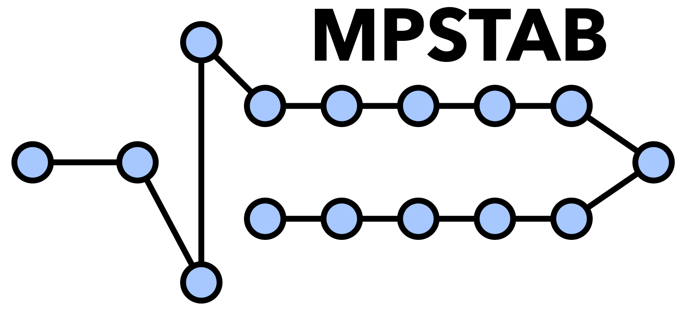

<div align="center">

<picture>
  <source media="(prefers-color-scheme: dark)" srcset="https://raw.githubusercontent.com/MatteoRobbiati/mpstab/main/docs/_static/logo/mpstab_logo_dark.png">
  
</picture>

### Hybrid stabilizers tensor-networks quantum circuit simulator

Clifford speed where the circuit is Clifford, tensor-network accuracy where it isn't.

[](https://pypi.org/project/mpstab/)
[](https://arxiv.org/abs/2607.24258)
[](https://github.com/MatteoRobbiati/mpstab/actions/workflows/tests.yml)
[](https://codecov.io/gh/MatteoRobbiati/mpstab)
[](https://matteorobbiati.github.io/mpstab/)
[](https://www.python.org/)
[](https://github.com/MatteoRobbiati/mpstab/blob/main/LICENSE)

[**Docs**](https://matteorobbiati.github.io/mpstab/) ·
[**Quick start**](#-quick-start) ·
[**Paper**](https://arxiv.org/abs/2607.24258) ·
[**Issues**](https://github.com/MatteoRobbiati/mpstab/issues)

</div>

---

**mpstab** simulates quantum circuits with the **hybrid stabilizer–Matrix Product Operator (HSMPO)** formalism
([Mello, Santini & Collura, PRL 2024](https://journals.aps.org/prl/abstract/10.1103/PhysRevLett.133.150604)):
Clifford gates are absorbed by a stabilizer tableau, and only the non-stabilizer part is carried by an MPO.
Circuits that are both highly entangled and moderately non-Clifford become tractable.

## ✨ Features

| | |
|---|---|
| 🧬 **Hybrid evolution** | Stabilizer and tensor-network engines combined: in-house, [Stim](https://github.com/quantumlib/Stim) or [Quimb](https://quimb.readthedocs.io/) |
| ⚙️ **Qibo native** | Use [Qibo](https://qibo.science/) circuits and observables, or `mpstab` as a Qibo backend |
| 🌫️ **Fast noise** | Pauli, coherent, non-unital, crosstalk, idle, prep and readout noise, no density matrix |
| 🛡️ **Error mitigation** | Clifford data regression (CDR, vnCDR) trained with HSMPO |
| 📈 **Analytic gradients** | Every parameter in one forward and one backward pass |
| 📊 **Metrics** | Fidelity lower bounds, truncation tracking, entanglement entropies |
| 🧩 **Ansätze** | Ready-made circuits: hardware-efficient, kicked Ising, QFT, QPE, Grover, … |

## 📦 Installation

```bash
pip install mpstab
```

Optional backends: `pip install "mpstab[pytorch]"` or `pip install "mpstab[jax]"`.

<details>
<summary>From source, with optional backends and dependency groups</summary>

```bash
git clone https://github.com/MatteoRobbiati/mpstab.git && cd mpstab
uv sync                    # or: pip install .
```

| What | uv | pip |
|---|---|---|
| PyTorch backend | `uv sync --extra pytorch` | `pip install ".[pytorch]"` |
| JAX backend | `uv sync --extra jax` | `pip install ".[jax]"` |
| rustiq resynthesis | `uv sync --group rustiq` | `pip install git+https://github.com/smartiel/rustiq.git` |
| Tests | `uv sync --group test` | |
| Docs | `uv sync --group docs` | |
| Dev tools | `uv sync --group dev` | |
| Everything | `uv sync --all-extras --all-groups` | |

Don't have [uv](https://docs.astral.sh/uv/)? `curl -LsSf https://astral.sh/uv/install.sh | sh`

</details>

## 🚀 Quick start

Energy and gradient of a 40-qubit J1-J2 Heisenberg chain, built with Qibo symbols.
A statevector would need 2⁴⁰ amplitudes; the HSMPO keeps the Clifford part in a tableau
and only the rest in a bond-dimension-64 MPO:

```python
from qibo.hamiltonians import SymbolicHamiltonian
from qibo.symbols import X, Y, Z

from mpstab import HSMPO
from mpstab.models.ansatze import HammingWeightPreserving

n, j1, j2 = 40, 1.0, 0.5

# H = J1 Σ σ_i·σ_{i+1} + J2 Σ σ_i·σ_{i+2}, periodic boundaries
form = sum(
    j * sum(P(i) * P((i + d) % n) for P in (X, Y, Z))
    for d, j in ((1, j1), (2, j2))
    for i in range(n)
)
hamiltonian = SymbolicHamiltonian(form, nqubits=n)

# 2-layer Hamming-weight-preserving ansatz, simulated with MPO bond dimension ≤ 64
ansatz = HammingWeightPreserving(nqubits=n, nlayers=2)
surrogate = HSMPO(ansatz, max_bond_dimension=64)

# fidelity: lower bound on the fidelity of the truncated MPO state
energy, fidelity = surrogate.expectation(hamiltonian, return_fidelity=True)
gradient = surrogate.gradient(hamiltonian)  # all 320 derivatives, one backward pass
```

<details>
<summary><b>Noisy expectation values</b></summary>

```python
from qibo import gates
from mpstab import HSMPO, DepolarizingError, NoiseModel, PauliError, ReadoutError
from mpstab.models.ansatze import KickedIsing

surrogate = HSMPO(KickedIsing(nqubits=4, n_steps=1, theta_h=0.7, theta_z=0.3))

noise = NoiseModel()
noise.add(PauliError({"X": 1e-3, "Y": 1e-3, "Z": 1e-3}))
noise.add(DepolarizingError(0.01), gates.CNOT)
noise.add(ReadoutError(0.01, 0.03))

result = surrogate.noisy_expectation("ZIIZ", noise, n_samples=500, seed=0)
print(f"{result.mean:+.4f} ± {result.stderr:.4f}")
```

</details>

<details>
<summary><b>mpstab as a Qibo backend</b></summary>

```python
from qibo import Circuit, construct_backend, gates
from qibo.hamiltonians import TFIM

circuit = Circuit(8)
circuit.add(gates.H(q) for q in range(8))
circuit.add(gates.RY(q, theta=0.3) for q in range(8))
circuit.add(gates.CNOT(0, 1))

hamiltonian = TFIM(nqubits=8, h=0.5, backend=construct_backend("mpstab"), dense=False)
print(hamiltonian.expectation(circuit))
```

</details>

More in the [tutorials](https://matteorobbiati.github.io/mpstab/tutorials/index.html):
noise, error mitigation, ground states, VQE gradients, state metrics, …

## 🛠️ Development

```bash
uv sync --all-extras --all-groups
pre-commit install                                      # formatting on every commit
uv run pytest --cov=mpstab --cov-report=html            # tests + coverage
uv run sphinx-build -b html docs docs/_build/html       # docs
```

**Contributing** — PRs welcome! Fork, branch, and open a pull request with:

- ✅ tests for every new feature, all passing locally
- 📝 Google-style docstrings for public functions and classes, docs updated with the API
- ▶️ executable docs examples: every `::` block in `docs/**/*.rst` runs as a test
  (`pytest tests/test_rst_code_blocks.py`), so each needs its own imports and variables

## 📖 Citation

If you use `mpstab`, please cite:

```bibtex
@misc{crognaletti2026mpstab,
  title         = {MPStab: an hybrid stabilizers tensor-network quantum circuit simulator},
  author        = {Giulio Crognaletti and Mattia Robbiano and Michele Grossi and Matteo Robbiati},
  year          = {2026},
  eprint        = {2607.24258},
  archivePrefix = {arXiv},
  primaryClass  = {quant-ph},
  url           = {https://arxiv.org/abs/2607.24258},
}
```

## 👥 Authors

Matteo Robbiati · Giulio Crognaletti · Mattia Robbiano · Roberto Di Lauro · Michele Grossi

Questions or ideas? Open an [issue](https://github.com/MatteoRobbiati/mpstab/issues) or a
[discussion](https://github.com/MatteoRobbiati/mpstab/discussions).
Released under the [Apache 2.0 License](https://github.com/MatteoRobbiati/mpstab/blob/main/LICENSE).
