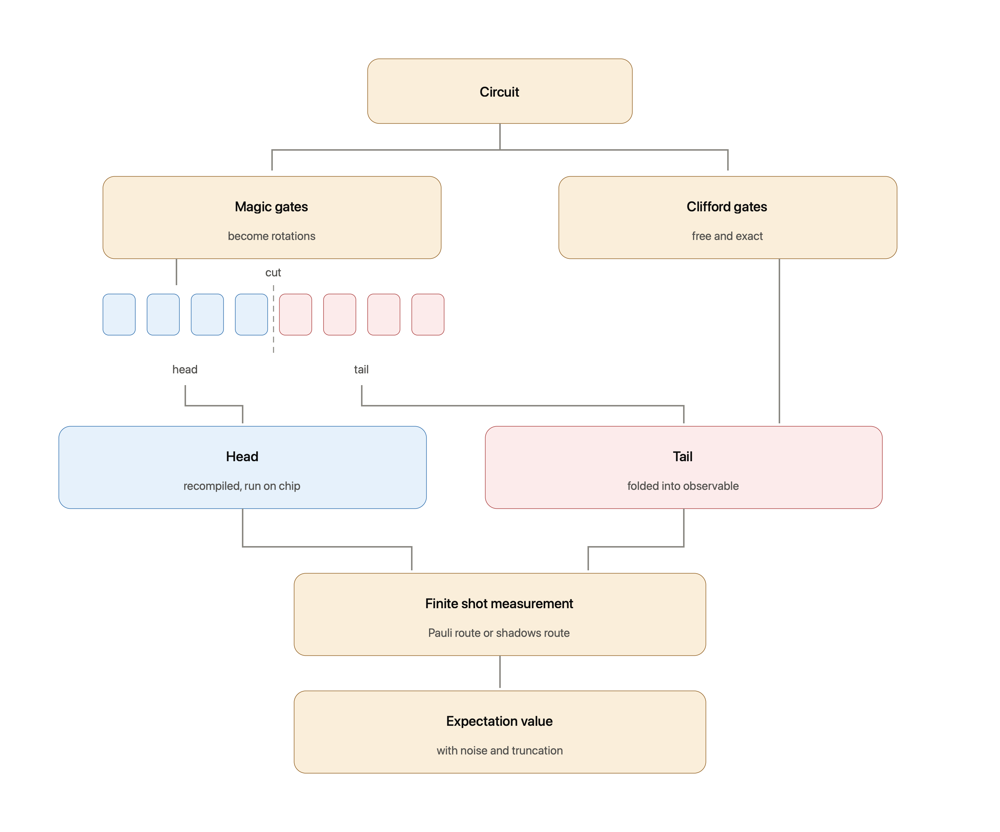
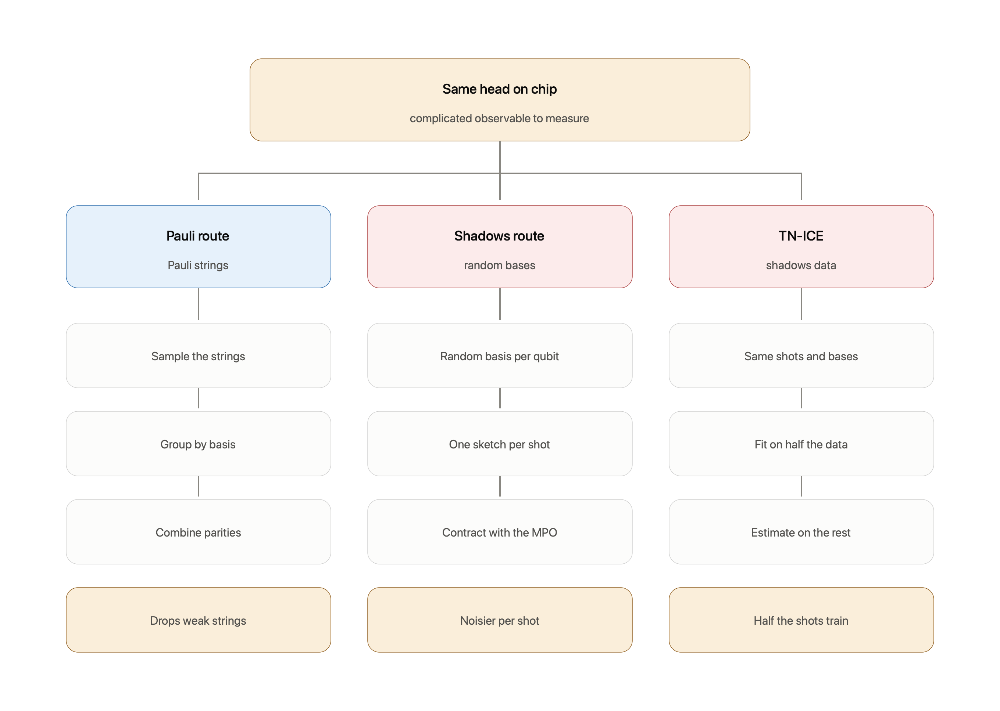
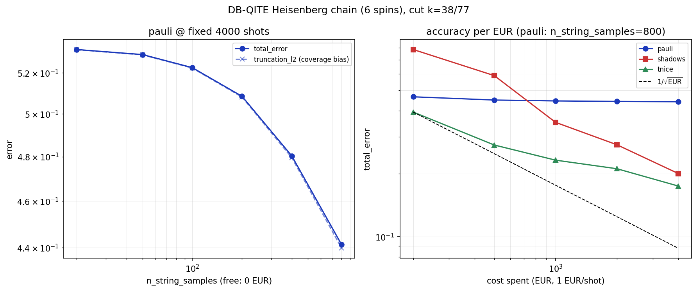

HSynthSMPO on quantum hardware
==============================

:class:`~mpstab.HSynthSMPO` splits the chain of dressed Pauli rotations at a
cut: the *head*, next to the initial state, is resynthesized into native
gates and run on a device, while the *tail*, next to the observable, is folded
into the observable as an MPO.

The folded observable is then measured along one of three routes:

With the optional rustiq extra (``pip install "mpstab[rustiq]"``) the head is
gate-count optimized; otherwise both scripts fall back to a dependency-free
decomposition.

Approximation from folding the tail
-----------------------------------

Sweeps the cut at a fixed bond-dimension cap and shows the error of the folded
MPO growing as more rotations are pushed into the tail.

.. code-block:: bash

   uv run python examples/scripts/quantum_hardware/hsynthsmpo_mpo_approximation.py

.. literalinclude:: ../../../examples/scripts/quantum_hardware/hsynthsmpo_mpo_approximation.py
   :language: python

Measuring a resynthesized head with finite shots
------------------------------------------------

Resynthesizes every dressed rotation, measures the circuit with a finite shot
budget through the ``"pauli"`` route and checks the estimate against the
classical simulation.

.. code-block:: bash

   uv run python examples/scripts/quantum_hardware/hsynthsmpo_rustiq_fold.py

.. literalinclude:: ../../../examples/scripts/quantum_hardware/hsynthsmpo_rustiq_fold.py
   :language: python
