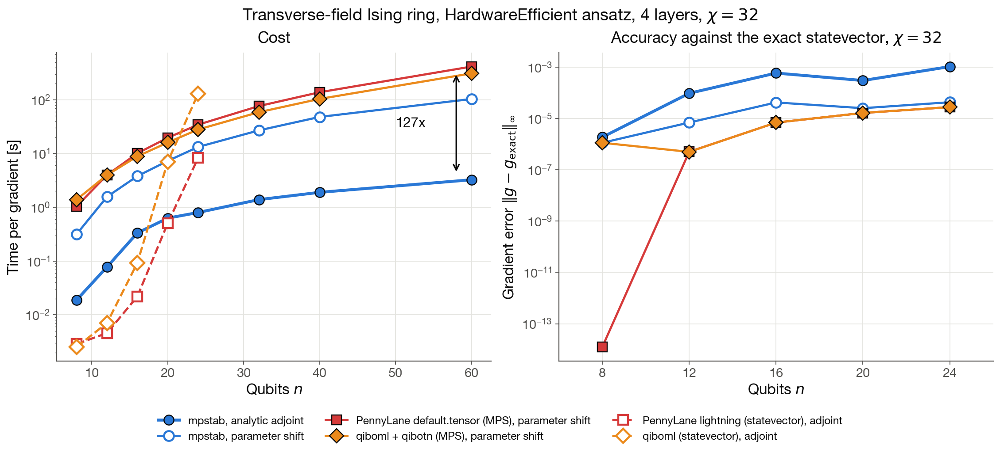
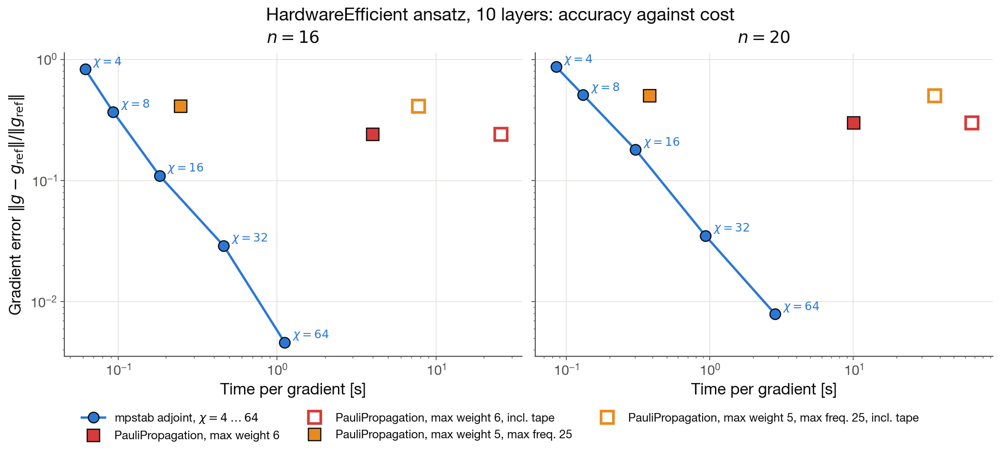
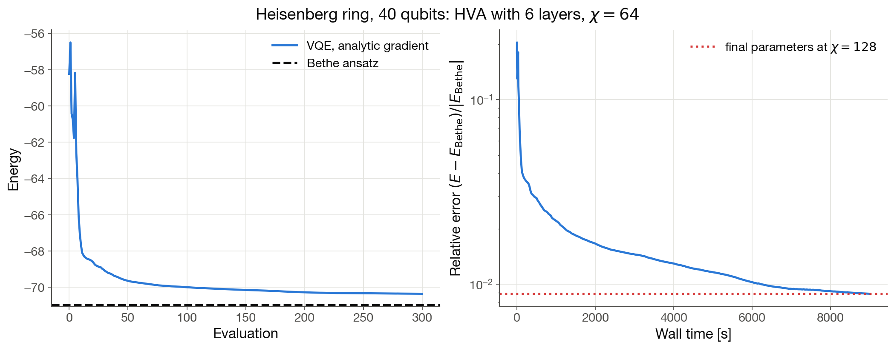

.. _analytic_gradients:

Analytic gradients
==================

:meth:`~mpstab.HSMPO.gradient` differentiates an expectation value with
respect to every parameter of the circuit at once. The cost is about that of
two evaluations of the energy, however many parameters there are. The
parameter-shift rule needs two shifted circuits *per parameter*: on 60 qubits
with 240 parameters, a gradient takes 3 s with mpstab and between 5 and 7
minutes with parameter-shift tensor-network gradients in PennyLane or qiboml.

This guide explains how the gradient is computed, what controls its accuracy,
and how it compares with other frameworks.

How it works
------------

The Clifford frame
^^^^^^^^^^^^^^^^^^

An HSMPO splits the circuit into a Clifford part, which stim keeps as a
tableau, and the non-Clifford rotations. Once the rotations are moved through
the Clifford gates ("dressed"), the state is a chain of Pauli rotations on the
initial MPS,

.. math::

   |\psi\rangle = R_R \cdots R_2 R_1 |\mathrm{init}\rangle,
   \qquad R_j = e^{-i \varphi_j G_j / 2},

where each :math:`G_j` is a Pauli string and each angle :math:`\varphi_j` is
a circuit parameter :math:`\theta` times a dressing sign :math:`s_j = \pm 1`.
The observable is dressed the same way into a Pauli sum
:math:`O = \sum_t c_t P_t`, and the energy is
:math:`f = \langle\psi|O|\psi\rangle / \langle\psi|\psi\rangle`.

The adjoint method
^^^^^^^^^^^^^^^^^^

Since :math:`\partial_{\varphi_j} R_j = -\tfrac{i}{2} G_j R_j`, write
:math:`|\psi_j\rangle = R_j \cdots R_1 |\mathrm{init}\rangle` for the state
after rotation :math:`j` and :math:`T_j = R_R \cdots R_{j+1}` for the rest of
the chain. Then

.. math::

   \frac{\partial f}{\partial \varphi_j}
   = \frac{\operatorname{Im} \langle \lambda_j | G_j | \psi_j \rangle}
          {\langle\psi|\psi\rangle},
   \qquad
   |\lambda_j\rangle = T_j^\dagger \, O \, |\psi\rangle .

The costate :math:`|\lambda_j\rangle` needs no new simulation for each
:math:`j`: :math:`|\lambda_{j-1}\rangle = R_j^\dagger |\lambda_j\rangle`. So
the whole gradient takes

1. **one forward pass** that applies the rotations to the MPS and keeps a
   checkpoint after each one (cheap, since the MPS kernels never write into
   existing tensors and a checkpoint shares them);
2. **one application of the Hamiltonian**, :math:`O|\psi\rangle`, compressed
   to the costate bond dimension;
3. **one backward pass** that undoes the rotations on the costate and reads
   one transition amplitude :math:`\langle\lambda_j|G_j|\psi_j\rangle` per
   rotation.

The energy itself comes out of the forward pass, so a training step needs no
separate evaluation (:meth:`~mpstab.HSMPO.value_and_gradient`).

The chain rule back to the circuit parameters sums
:math:`s_j \, \partial f / \partial \varphi_j` over the rotations of each
parameter's gate. Rotations outside the light cone of the observable are
dropped first, which is exact.

The sign-flip picture
^^^^^^^^^^^^^^^^^^^^^

Moving :math:`G_j` to the end of the chain flips the sign of every later angle
whose generator anticommutes with it: this is exactly the sign pattern a Pauli
fault after rotation :math:`j` produces in :mod:`mpstab.models.noise`. Read
forward, the same formula gives ``method="flips"``, one flipped tail per
parameter and one transition amplitude per Hamiltonian term. It is slower than
the adjoint for many parameters, but has no costate to truncate.

Both methods equal the parameter-shift rule: without truncation they agree
with it to about :math:`10^{-15}` and with the exact statevector gradient to
about :math:`10^{-10}`.

Parameters at Clifford angles
^^^^^^^^^^^^^^^^^^^^^^^^^^^^^

A rotation whose angle is a multiple of :math:`\pi/2` (zero included) is a
Clifford gate: mpstab absorbs it into the tableau, so it has no rotation in the
chain to differentiate. Asking for its derivative raises a ``ValueError``
rather than silently returning zero. Initialize parameters away from those
values, e.g. with small random angles.

Accuracy and truncation
-----------------------

With a finite bond dimension :math:`\chi`, the gradient is the gradient of the
truncated surrogate. Two things set its error:

* **The state.** The gradient is an overlap, so its error is of *first* order
  in the truncation error of :math:`|\psi\rangle`, while an energy (and so a
  parameter-shift gradient) is of second order. At equal :math:`\chi`, the
  adjoint gradient is therefore somewhat less accurate than the
  parameter-shift one (right panel of the figure below), and the truncation
  fidelity reported by :func:`~mpstab.evolutors.gradient.analytic_gradient`
  tracks its error well.
* **The costate.** :math:`O|\psi\rangle` is a sum of many Pauli strings and has
  a larger bond dimension than :math:`|\psi\rangle`. By default it is capped at
  :math:`2\chi`; ``costate_bond=chi`` is about twice as fast for about twice the
  error, and going above :math:`2\chi` does not help.

To check a trained circuit, evaluate the final parameters again at a larger
bond dimension, as the Bethe-ansatz example below does.

Usage
-----

.. code-block:: python

    import numpy as np
    from mpstab import HSMPO
    from mpstab.models.ansatze import HardwareEfficient

    np.random.seed(0)
    surrogate = HSMPO(HardwareEfficient(nqubits=20, nlayers=4), max_bond_dimension=32)
    hamiltonian = {"ZZ" + "I" * 18: -1.0, "X" + "I" * 19: -1.0}

    gradient = surrogate.gradient(hamiltonian)                 # one per parameter
    energy, gradient = surrogate.value_and_gradient(hamiltonian)

    # A VQE on the surrogate: Adam or L-BFGS on the analytic gradient.
    result = surrogate.optimize_parameters(hamiltonian, method="lbfgs", max_steps=100)
    print(result["energy"], result["num_steps"])

``optimize_parameters`` leaves the surrogate at the best parameters found and
returns them, as circuit parameters that can run on any backend or device.

Benchmarks
----------

All timings are on a laptop (Apple M4, 16 GB), and all circuits are noiseless.

Against PennyLane and qiboml
^^^^^^^^^^^^^^^^^^^^^^^^^^^^

The energy of the transverse-field Ising ring on the
:class:`~mpstab.models.ansatze.HardwareEfficient` ansatz with 4 layers (RY
rotations and a ring of CZ gates), differentiated at the same random
parameters. Tensor-network methods share the bond dimension :math:`\chi = 32`;
statevector methods are exact and stop at 24 qubits.

* **Cost (left).** Statevector adjoint differentiation is the fastest up to
  about 20 qubits, then grows exponentially. Among tensor-network methods,
  which all scale polynomially, the mpstab adjoint is 25 to 130 times faster
  than parameter-shift gradients in PennyLane (``default.tensor``) and qiboml
  (qibotn), and 10 to 30 times faster than parameter shift on mpstab's own
  surrogate, the gap growing with the number of parameters. On 60 qubits: 3.3 s, against 310 s (qiboml) and 414 s
  (PennyLane).
* **Accuracy (right).** All tensor-network gradients are within about
  :math:`10^{-3}` of the exact one. The adjoint error is larger than the
  parameter-shift one at the same :math:`\chi`, as explained above.

Parameter-shift times are measured on a few parameters and scaled to all of
them. qiboml's tensor-network autodiff (``QuimbJax``) does not run with the
current qiboml and qibotn releases and is not included.

Against PauliPropagation
^^^^^^^^^^^^^^^^^^^^^^^^

`PauliPropagation.jl <https://github.com/MSRudolph/PauliPropagation.jl>`_
propagates the observable backwards as a truncated sum of Pauli strings, and
differentiates it by reverse-mode automatic differentiation (ReverseDiff,
with a compiled tape). On shallow circuits (4 layers) it is very competitive:
untruncated, it is exact and faster than mpstab up to about 40 qubits. On
deeper circuits the number of Pauli strings explodes and it has to be
truncated (here by Pauli weight and frequency). Each mpstab point below is a
bond dimension, so the two methods can be compared at equal accuracy:

With 10 layers, truncated PauliPropagation leaves 25-60 % error in the
gradient. mpstab is already more accurate at :math:`\chi = 16`, in 0.2-0.3 s
against 4-10 s for the Pauli-weight truncation, and its error keeps falling
with :math:`\chi`, below 1 % at :math:`\chi = 64` in 1-3 s. Hollow squares add the one-time cost of recording
and compiling the tape. Untruncated PauliPropagation is already out of reach
at 6 layers on 12 qubits. The reference is the exact gradient up to 16 qubits and
mpstab at :math:`\chi = 256` above.

A VQE on 40 qubits, against the Bethe ansatz
^^^^^^^^^^^^^^^^^^^^^^^^^^^^^^^^^^^^^^^^^^^^

The periodic Heisenberg chain
:math:`H = \sum_i (X_i X_{i+1} + Y_i Y_{i+1} + Z_i Z_{i+1})` is integrable, and
its ground energy follows from the Bethe equations for any size. A Hamiltonian
variational ansatz (a product of singlets, then 6 layers of RZZ, RXX and RYY
rotations on alternating bonds, 720 parameters) is trained with
:meth:`~mpstab.HSMPO.optimize_parameters` (L-BFGS) at :math:`\chi = 64`:

After 300 gradient evaluations (2.5 hours, 30 s each) the energy is within
0.9 % of the Bethe-ansatz value. Evaluated again at :math:`\chi = 128` (red
line), the same parameters give the same energy within :math:`4 \cdot
10^{-4}`, so the remaining gap comes from the ansatz, not from the truncation.
The same training with the parameter-shift rule would need 1440 energy
evaluations per step, about 390 hours in total.

Reproducing the benchmarks
^^^^^^^^^^^^^^^^^^^^^^^^^^

The scripts are in ``examples/scripts/gradient/``; each one documents its
options and dependencies at the top:

* ``gradient_frameworks.py``: PennyLane and qiboml;
* ``gradient_paulipropagation.py``: PauliPropagation.jl, through juliacall,
  e.g. ``--nlayers 10 --bonds 4 8 16 32 64``;
* ``vqe_heisenberg_bethe.py``: the 40-qubit VQE;
* ``vqe_training.py``: a VQE trained with the analytic gradient and with the
  parameter-shift rule, side by side;
* ``gradient_vs_psr.py``: mpstab's analytic gradient against its own
  parameter-shift rule.

The :doc:`../tutorials/vqe_gradients` tutorial walks through a full training
step by step.

Limitations
-----------

* Gradients are noiseless: under a noise model, the gradient would be an
  average over fault patterns, which is not implemented.
* The parameters of the head that :class:`~mpstab.evolutors.hqsmpo.HQSMPO`
  runs on hardware still need shifted circuits.
* Gradients need the :class:`~mpstab.engines.QuimbEngine` (the default),
  which computes transition amplitudes and applies Pauli sums to a state.
