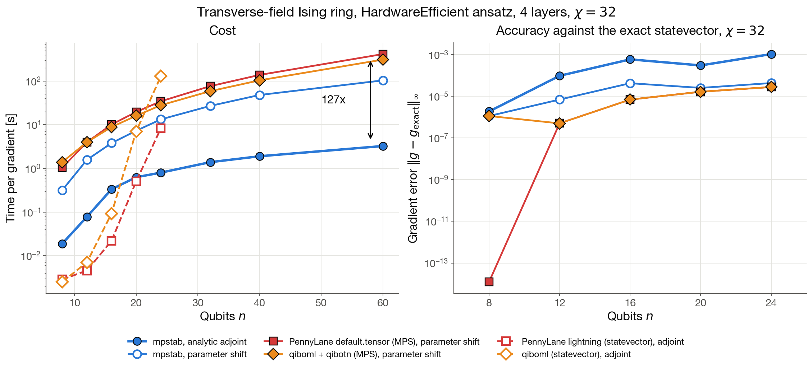
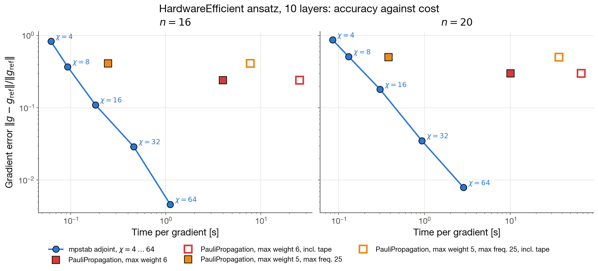
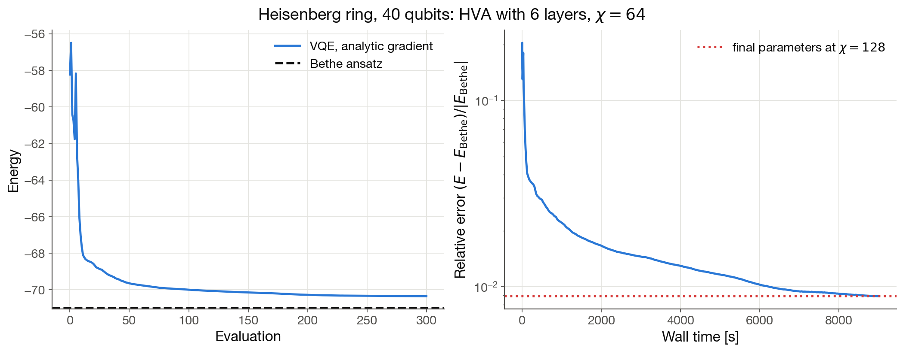

.. _analytic_gradients:

Analytic gradients
==================

A variational algorithm, such as a VQE, tunes the angles :math:`\theta` of a
circuit to minimize an energy :math:`f(\theta) = \langle O \rangle`, and needs
the gradient :math:`\nabla f` at every step. On a quantum computer the gradient
comes from the *parameter-shift rule*: two extra circuits per parameter, so a
circuit with :math:`P` parameters costs :math:`2P` evaluations per step.

:meth:`~mpstab.HSMPO.gradient` computes all the derivatives at once, for about
the cost of **two** evaluations, however many parameters there are. On 60
qubits with 240 parameters a gradient takes 3 s with mpstab, against 5 to 7
minutes with parameter-shift tensor-network gradients in PennyLane or qiboml.

This page builds the method step by step: what mpstab differentiates, why one
derivative is a transition amplitude, how a single backward pass gives all of
them, and what limits the accuracy.

Step 1: the circuit as a chain of rotations
-------------------------------------------

An HSMPO keeps the Clifford gates of a circuit in a stabilizer tableau and the
non-Clifford rotations in an MPS (see :doc:`theory_background`). Every rotation
is moved through the Clifford gates that precede it: a Clifford conjugates a
Pauli string into another Pauli string, so the rotation stays a rotation, about
a new, *dressed* string. What reaches the MPS is a chain of Pauli rotations,

.. math::

   |\psi\rangle = R_R \cdots R_2 R_1 |\mathrm{init}\rangle,
   \qquad R_j = e^{-i \varphi_j G_j / 2},

where each generator :math:`G_j` is a Pauli string and each angle
:math:`\varphi_j` is a circuit parameter times a sign :math:`s_j = \pm 1` picked
up in the dressing. The observable is dressed the same way into a Pauli sum
:math:`O = \sum_t c_t P_t`, and the energy is

.. math::

   f = \frac{\langle\psi|\,O\,|\psi\rangle}{\langle\psi|\psi\rangle}.

The denominator is 1 for an exact state; it is kept because a truncated MPS
loses a little norm. From here on only this chain matters: differentiating the
circuit means differentiating it.

Step 2: one derivative is a transition amplitude
------------------------------------------------

A rotation about a Pauli string has a simple derivative,

.. math::

   \frac{\partial R_j}{\partial \varphi_j} = -\frac{i}{2}\, G_j\, R_j,

so differentiating :math:`f` with respect to :math:`\varphi_j` inserts the Pauli
string :math:`G_j` right after rotation :math:`j`, with a factor
:math:`-i/2`:

.. themed-figure:: ../_static/figures/derivative_as_fault.svg
   :align: center
   :width: 100%

Call :math:`|\psi_j\rangle = R_j \cdots R_1 |\mathrm{init}\rangle` the state
after rotation :math:`j`, and :math:`T_j = R_R \cdots R_{j+1}` the rotations
after it, so that :math:`|\psi\rangle = T_j |\psi_j\rangle`. The product rule
on :math:`\langle\psi|O|\psi\rangle` gives two complex-conjugate terms, hence
twice a real part:

.. math::

   \frac{\partial f}{\partial \varphi_j}
   = \frac{2\,\mathrm{Re}\,\langle\psi|\, O\, T_j \left(-\tfrac{i}{2} G_j\right) |\psi_j\rangle}{\langle\psi|\psi\rangle}
   = \frac{\operatorname{Im} \langle \lambda_j |\, G_j\, | \psi_j \rangle}{\langle\psi|\psi\rangle},
   \qquad
   |\lambda_j\rangle = T_j^\dagger \, O \, |\psi\rangle .

The derivative is the overlap of two states with :math:`G_j` between them: the
state :math:`|\psi_j\rangle` coming forward from the input, and the
**costate** :math:`|\lambda_j\rangle`, which is :math:`O|\psi\rangle` brought
*backwards* through the rotations after :math:`j`.

.. admonition:: Check on one qubit

   Take one rotation :math:`R_Y(\varphi)` on :math:`|0\rangle` and
   :math:`O = Z`, so :math:`f = \cos\varphi`. Here :math:`T` is empty,
   :math:`|\lambda\rangle = Z|\psi\rangle` and :math:`ZY = -iX`, so
   :math:`\operatorname{Im}\langle\psi|ZY|\psi\rangle = -\langle\psi|X|\psi\rangle = -\sin\varphi`,
   which is indeed :math:`\partial_\varphi \cos\varphi`.

Step 3: all derivatives in one backward pass
--------------------------------------------

Computed one by one, each costate would need its own pass through the end of
the chain, and the gradient would cost :math:`R` simulations, no better than
the parameter-shift rule. But consecutive costates differ by a single
rotation,

.. math::

   |\lambda_{j-1}\rangle = R_j^\dagger\, |\lambda_j\rangle,
   \qquad |\lambda_R\rangle = O\,|\psi\rangle,

so one sweep from the end of the chain to its start visits all of them. This
is the *adjoint method*, the same idea as backpropagation in neural networks:

.. themed-figure:: ../_static/figures/adjoint_passes.svg
   :align: center
   :width: 100%

The gradient takes

1. **one forward pass**, which applies the rotations to the MPS and keeps the
   state after each one. A checkpoint is cheap: the MPS kernels replace the
   tensors a rotation touches instead of writing into them, so consecutive
   checkpoints share every other tensor;
2. **one application of the observable**, :math:`O|\psi\rangle`, compressed
   to the bond dimension of the costate;
3. **one backward pass**, which undoes the rotations on the costate and reads
   one transition amplitude :math:`\langle\lambda_j|G_j|\psi_j\rangle` per
   rotation.

That is about :math:`2R` rotations, whatever the number of parameters. The
energy itself comes out of the forward pass, so a training step needs no
separate evaluation (:meth:`~mpstab.HSMPO.value_and_gradient`).

Step 4: back to the circuit parameters
--------------------------------------

The derivatives above are with respect to the angles :math:`\varphi_j` of the
chain. A circuit parameter :math:`\theta` reaches the chain through
:math:`\varphi_j = s_j\,\theta`, once for each rotation of its gate, so

.. math::

   \frac{\partial f}{\partial \theta} = \sum_{j \,\in\, \text{rotations of } \theta} s_j\, \frac{\partial f}{\partial \varphi_j}.

Before any of this, the rotations outside the *light cone* of the observable
are dropped: going backwards from :math:`O`, a rotation matters only if its
generator anticommutes with the observable or with a later rotation that
matters. The others cancel exactly in :math:`\langle\psi|O|\psi\rangle`, and
their parameters have zero derivative.

The same formula, read as noise
-------------------------------

Step 2 inserted a Pauli string :math:`G_j` after rotation :math:`j`. That is
exactly what a Pauli *fault* does in a noisy circuit, and mpstab handles it the
same way (see the :doc:`../tutorials/noise` tutorial): instead of bringing the
observable backwards, slide :math:`G_j` forward to the end of the chain. A
Pauli commutes with a rotation about a commuting string and flips the sign of
the angle of an anticommuting one, so

.. math::

   \frac{\partial f}{\partial \varphi_j} = \sum_t c_t \operatorname{Im}\, \langle\psi|\, P_t\, G_j\, |\tilde\psi_j\rangle,

where :math:`|\tilde\psi_j\rangle` is the chain with the angles of the later
rotations that anticommute with :math:`G_j` negated. ``method="flips"``
evaluates this form: one shifted tail per parameter, one transition amplitude
per Hamiltonian term. It applies :math:`O(PR)` rotations instead of
:math:`2R`, but has no costate to compress.

Both methods are exact rewritings of the parameter-shift rule: without
truncation they agree with it to about :math:`10^{-15}`, and with the exact
statevector gradient to about :math:`10^{-10}`.

Parameters at Clifford angles
-----------------------------

A rotation whose angle is a multiple of :math:`\pi/2` (zero included) is a
Clifford gate. mpstab absorbs it into the tableau, so it has no rotation in the
chain to differentiate. Asking for its derivative raises a ``ValueError``
rather than silently returning zero. Initialize parameters away from those
values, e.g. with small random angles.

Accuracy and truncation
-----------------------

With a finite bond dimension :math:`\chi` the gradient is that of the truncated
surrogate. Two things set its error.

* **The state.** The gradient is an overlap, so its error is of *first* order
  in the truncation error of :math:`|\psi\rangle`, while an energy (and so a
  parameter-shift gradient) is of second order. At equal :math:`\chi` the
  adjoint gradient is therefore somewhat less accurate than the
  parameter-shift one (right panel of the figure below). The truncation
  fidelity reported by :func:`~mpstab.evolutors.gradient.analytic_gradient`
  tracks its error well.
* **The costate.** :math:`O|\psi\rangle` is a sum of many Pauli strings applied
  to the state, so it needs a larger bond dimension than :math:`|\psi\rangle`.
  By default it is capped at :math:`2\chi`; ``costate_bond=chi`` is about twice
  as fast for about twice the error, and going above :math:`2\chi` does not
  help.

To check a trained circuit, evaluate the final parameters again at a larger
bond dimension, as the Bethe-ansatz example below does.

Usage
-----

.. code-block:: python

    import numpy as np
    from mpstab import HSMPO
    from mpstab.models.ansatze import HardwareEfficient

    np.random.seed(0)
    surrogate = HSMPO(HardwareEfficient(nqubits=20, nlayers=4), max_bond_dimension=32)
    hamiltonian = {"ZZ" + "I" * 18: -1.0, "X" + "I" * 19: -1.0}

    gradient = surrogate.gradient(hamiltonian)                 # one per parameter
    energy, gradient = surrogate.value_and_gradient(hamiltonian)

    # A VQE on the surrogate: Adam or L-BFGS on the analytic gradient.
    result = surrogate.optimize_parameters(hamiltonian, method="lbfgs", max_steps=100)
    print(result["energy"], result["num_steps"])

``optimize_parameters`` leaves the surrogate at the best parameters found and
returns them, as circuit parameters that can run on any backend or device.

Benchmarks
----------

All timings are on a laptop (Apple M4, 16 GB), and all circuits are noiseless.

Against PennyLane and qiboml
^^^^^^^^^^^^^^^^^^^^^^^^^^^^

The energy of the transverse-field Ising ring on the
:class:`~mpstab.models.ansatze.HardwareEfficient` ansatz with 4 layers (RY
rotations and a ring of CZ gates), differentiated at the same random
parameters. Tensor-network methods share the bond dimension :math:`\chi = 32`;
statevector methods are exact and stop at 24 qubits.

* **Cost (left).** Statevector adjoint differentiation is the fastest up to
  about 20 qubits, then grows exponentially. Among tensor-network methods,
  which all scale polynomially, the mpstab adjoint is 25 to 130 times faster
  than parameter-shift gradients in PennyLane (``default.tensor``) and qiboml
  (qibotn), and 10 to 30 times faster than parameter shift on mpstab's own
  surrogate, the gap growing with the number of parameters. On 60 qubits: 3.3 s, against 310 s (qiboml) and 414 s
  (PennyLane).
* **Accuracy (right).** All tensor-network gradients are within about
  :math:`10^{-3}` of the exact one. The adjoint error is larger than the
  parameter-shift one at the same :math:`\chi`, as explained above.

Parameter-shift times are measured on a few parameters and scaled to all of
them. qiboml's tensor-network autodiff (``QuimbJax``) does not run with the
current qiboml and qibotn releases and is not included.

Against PauliPropagation
^^^^^^^^^^^^^^^^^^^^^^^^

`PauliPropagation.jl <https://github.com/MSRudolph/PauliPropagation.jl>`_
propagates the observable backwards as a truncated sum of Pauli strings, and
differentiates it by reverse-mode automatic differentiation (ReverseDiff,
with a compiled tape). On shallow circuits (4 layers) it is very competitive:
untruncated, it is exact and faster than mpstab up to about 40 qubits. On
deeper circuits the number of Pauli strings explodes and it has to be
truncated (here by Pauli weight and frequency). Each mpstab point below is a
bond dimension, so the two methods can be compared at equal accuracy:

With 10 layers, truncated PauliPropagation leaves 25-60 % error in the
gradient. mpstab is already more accurate at :math:`\chi = 16`, in 0.2-0.3 s
against 4-10 s for the Pauli-weight truncation, and its error keeps falling
with :math:`\chi`, below 1 % at :math:`\chi = 64` in 1-3 s. Hollow squares add the one-time cost of recording
and compiling the tape. Untruncated PauliPropagation is already out of reach
at 6 layers on 12 qubits. The reference is the exact gradient up to 16 qubits and
mpstab at :math:`\chi = 256` above.

A VQE on 40 qubits, against the Bethe ansatz
^^^^^^^^^^^^^^^^^^^^^^^^^^^^^^^^^^^^^^^^^^^^

The periodic Heisenberg chain
:math:`H = \sum_i (X_i X_{i+1} + Y_i Y_{i+1} + Z_i Z_{i+1})` is integrable, and
its ground energy follows from the Bethe equations for any size. A Hamiltonian
variational ansatz (a product of singlets, then 6 layers of RZZ, RXX and RYY
rotations on alternating bonds, 720 parameters) is trained with
:meth:`~mpstab.HSMPO.optimize_parameters` (L-BFGS) at :math:`\chi = 64`:

After 300 gradient evaluations (2.5 hours, 30 s each) the energy is within
0.9 % of the Bethe-ansatz value. Evaluated again at :math:`\chi = 128` (red
line), the same parameters give the same energy within :math:`4 \cdot
10^{-4}`, so the remaining gap comes from the ansatz, not from the truncation.
The same training with the parameter-shift rule would need 1440 energy
evaluations per step, about 390 hours in total.

Reproducing the benchmarks
^^^^^^^^^^^^^^^^^^^^^^^^^^

The scripts are in ``examples/scripts/gradient/``; each one documents its
options and dependencies at the top:

* ``gradient_frameworks.py``: PennyLane and qiboml;
* ``gradient_paulipropagation.py``: PauliPropagation.jl, through juliacall,
  e.g. ``--nlayers 10 --bonds 4 8 16 32 64``;
* ``vqe_heisenberg_bethe.py``: the 40-qubit VQE;
* ``vqe_training.py``: a VQE trained with the analytic gradient and with the
  parameter-shift rule, side by side;
* ``gradient_vs_psr.py``: mpstab's analytic gradient against its own
  parameter-shift rule.

The :doc:`../tutorials/vqe_gradients` tutorial walks through a full training
step by step.

Limitations
-----------

* Gradients are noiseless: under a noise model, the gradient would be an
  average over fault patterns, which is not implemented.
* The parameters of the head that :class:`~mpstab.evolutors.hqsmpo.HQSMPO`
  runs on hardware still need shifted circuits.
* Gradients need the :class:`~mpstab.engines.QuimbEngine` (the default),
  which computes transition amplitudes and applies Pauli sums to a state.
