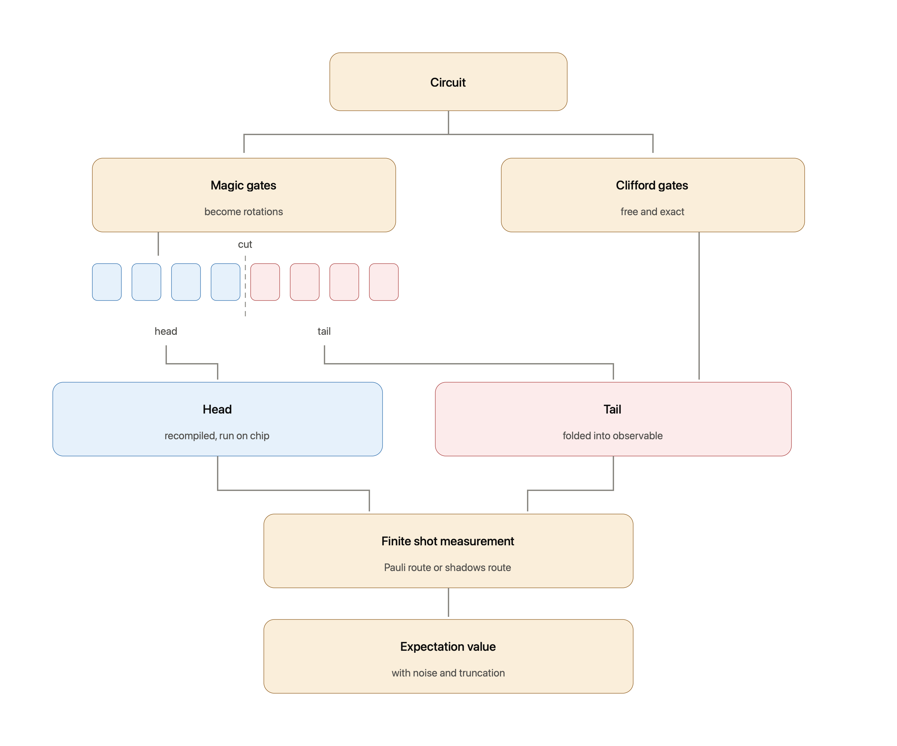
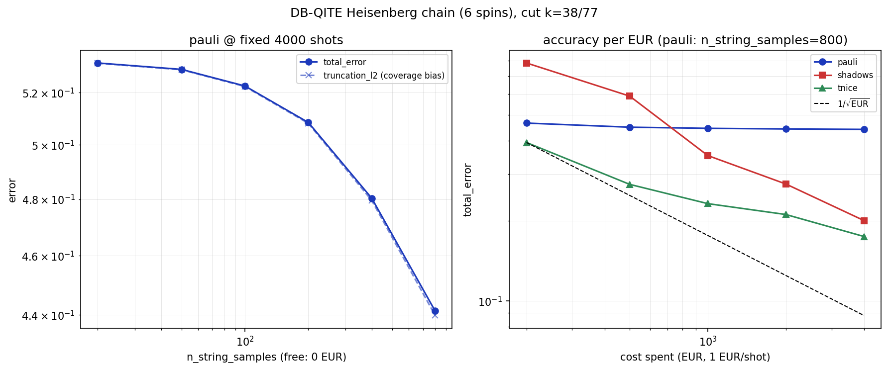

# QPU: running a head/tail split on a device

This package answers one question: **given a circuit that `HQSMPO` (Hybrid Quantum Stabilizer Matrix Product Operator) has
split into a "head" and a "tail" at some cut point, how do we actually get an
expectation value out of real (or simulated) quantum hardware?**

## The problem in one picture

`HQSMPO` represents a circuit as a chain of "dressed" Pauli rotations. A
cut point `k` splits that chain in two: the magic (non-Clifford) gates become
rotations that get cut into a head and a tail; the Clifford gates are free and
exact, absorbed however they fall relative to the cut. The head is
resynthesised and run on the device; the tail is folded into the observable
classically, with no shot spent on it at all:



So instead of running the *whole* circuit and measuring `O`, we run only the
*head* on the device and measure a *different* operator `O'` -- the
tail's rotations folded into `O` -- that gives the exact same number. Moving
the cut point trades head depth (cost on the device) against `O'`'s
complexity (cost of turning it into something measurable). This package is
the second half of that trade: **turning `O'` into circuits, shots, and
finally a number, however global or entangled `O'` turned out to be.**

## The pipeline, one subpackage each

```
synthesis/      head's rotations   ->  a runnable circuit
                                        (+ a small Clifford leftover)
                rustiq.py, extraction.py, cnot_ladder.py; utils.py holds the
                gate-list format

measurement/    O' (as an MPO)     ->  which circuits to run, how many shots
                                        each (fixed BEFORE anything runs, so
                                        it can be replayed on a simulator or
                                        on real hardware)
                measured           ->  a value + its error bar
                frequencies
                one module per method: pauli.py, shadows.py;
                pauli_expansion.py turns O' into Pauli strings for them

execution/      a plan's circuits  ->  frequencies (simulator.py), or
                                        OpenQASM files for a device
                                        (qasm.py, storage.py)
```

`HQSMPO.expectation_at_cut` (in `mpstab.evolutors.hqsmpo`) is the one
function that runs all three steps and hands back the result. Everything
below explains what happens *inside* it.

On a real device the steps happen at different times, so they can also be run
one by one: `HQSMPO.plan` builds the plan and, given an `out_folder`, saves
its circuits as OpenQASM with their shots (`execution/storage.py`). A device backend runs
those files, and `estimate(plan, frequencies)` recombines the counts.

## Two ways to turn O' into a number

Both share the *same* first step (resynthesising the head into a circuit)
and differ only in what they measure and how they turn the results back into
a number.

### `"pauli"` -- sample and group

`O'` is (approximately) a sum of Pauli strings with coefficients. This route
samples the largest ones from the tail's MPO, groups strings that can be
measured together in one basis choice ("qubit-wise commuting" grouping), and
runs one circuit per group. Cheap in circuits, and the error has a clean
theoretical bound -- but it needs `O'`'s Pauli decomposition to actually be
concentrated on a manageable number of strings.

### `"shadows"` -- classical shadows

Measures each qubit in a uniformly random Pauli basis (X, Y or Z), one shot
per random choice. Every such shot is *informationally complete*: the same
measured data can, in principle, be reused to estimate *any* observable.
The catch is the fixed recipe used to turn a shot into a number (the
"canonical dual" contraction) can have very large variance for observables
that spread across many qubits -- a well-known limitation of classical
shadows with *local* random measurements.

## The two currencies

Every route spends two different things, and they don't trade off the same
way:

- **Quantum**: circuits executed on the device and shots spent. This is
  fixed once a route and a shot budget are chosen (`"pauli"` typically needs
  far fewer distinct circuits than `"shadows"`, which needs one random basis
  per shot by construction).
- **Classical**: the post-processing cost of `estimate()`, a fixed
  contraction for both routes.

## How much does accuracy actually cost?

The numbers below come from a circuit that has nothing to do with quantum
hardware design: a few steps of
Double-Bracket Quantum Imaginary-Time Evolution (`qrisp.algorithms.qite`,
arXiv:2412.04554) approximating the ground state of a 6-site Heisenberg
chain (8 physical qubits once `qrisp`'s own ancilla qubits are counted, 77
magic gates after `HQSMPO`'s Clifford/magic split). One
fixed cut, one fixed observable (a spin-spin correlator), pricing every shot
at 1 EUR:

### `"pauli"`'s other knob is free

`n_string_samples` (how many Pauli strings the sampler keeps from `O'`'s
decomposition) is chosen *before* any shot is spent -- raising it costs
exactly 0 EUR, only classical compute:



*(left panel)* At a fixed 4000-shot budget, `total_error` barely moves from
`n_string_samples=20` to `800` (0.53 -> 0.44) -- it's dominated almost
entirely by `truncation_l2`, the systematic bias from Pauli strings the
sampler never even considered, not by shot noise. No amount of *shots* fixes
that; only more *string samples* does, and on a circuit this entangled even
800 isn't close to enough (65 measurement settings and still falling).
**Moral: if `"pauli"`'s error stops improving as you add shots, check
`result.truncation_l2` before reaching for a bigger shot budget -- it's
usually the wrong knob.**

`truncation_l2` only counts the strings left unsampled *of the folded MPO as
it is*. If the tail was folded at a finite bond dimension, the MPO itself is
already an approximation: that bias is reported apart, as
`result.bond_truncation_l2` (the same norm-loss estimate `"shadows"` reports
as its `truncation_l2`), and is part of `total_error`. More string samples do
not reduce it; only a larger bond dimension, or a cut closer to the end, does.
`result.antihermitian_l2` is a diagnostic of the same truncation: the size of
the anti-Hermitian part it leaves in the sampled coefficients, which is
projected out before measuring.

### EUR spent vs accuracy

*(right panel, same figure; its third curve is the TN-ICE estimator that
mpstab no longer ships)* Fixing `"pauli"` at `n_string_samples=800` and
sweeping the shot budget:

| EUR spent | pauli | shadows |
|---:|---:|---:|
| 200  | **0.466** | 0.784 |
| 500  | **0.450** | 0.588 |
| 1000 | 0.445 | **0.352** |
| 2000 | 0.443 | **0.275** |
| 4000 | 0.441 | **0.200** |

(`total_error`, lower is better.) `"pauli"` is flat for the reason above (it
needs more `n_string_samples`, not more EUR); `"shadows"` improves steadily
along the `1/sqrt(EUR)` a statistically well-behaved estimator should
follow, and overtakes `"pauli"` around 1000 EUR.

**Extrapolating beyond the measured range is where this breaks down --
worth saying explicitly rather than glossing over.** Fitting a power law to
these five points and solving for "EUR needed to reach `total_error=0.07`"
gives `"shadows"` ~36,000 EUR, and `"pauli"` a physically meaningless
multi-digit-exponent number, because `"pauli"`'s curve isn't a power law at
all here -- it's a plateau (see above), and a power-law fit through five
nearly-flat points extrapolates nonsense the moment you ask it to reach below
that plateau. The lesson: **don't trust a cost extrapolation past the shot
range you actually measured**, especially for a route that's visibly not
shot-noise-limited yet.

## Where to look next

- `mpstab.evolutors.hqsmpo.HQSMPO.expectation_at_cut` -- the entry
  point; its docstring lists every argument each route accepts.
- `tests/test_expectation_methods.py`, `tests/test_pauli_sampling.py` --
  one route/module per test file, each checked
  against the exact (uncut) reference.
- `examples/scripts/quantum_hardware/` -- runnable examples: how folding
  the tail into the observable MPO introduces error
  (`hqsmpo_mpo_approximation.py`), and a fully resynthesized head
  measured with finite shots through the `"pauli"` route
  (`hqsmpo_rustiq_fold.py`).
